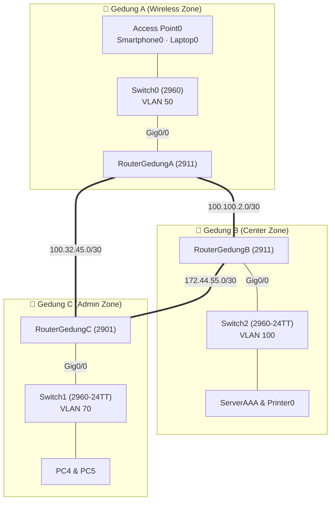

<div align="center">

# 🌐 Three-Building Enterprise Network

### Cisco Packet Tracer · 3 Routers · Multi-VLAN · OSPF · AAA Security · Wireless · DHCP


<br>


<sub>Full topology built in Cisco Packet Tracer</sub>

</div>

---

## 📑 Table of Contents

[Overview](#-overview) · [Highlights](#-highlights) · [Topology](#%EF%B8%8F-topology) · [VLAN Plan](#-vlan--subnet-plan) · [WAN Links](#-wan-links) · [Config Guide](#%EF%B8%8F-configuration-guide) · [AAA & Security](#%EF%B8%8F-aaa--local-authentication) · [Configs](#-full-device-configs) · [Testing](#-verification--testing) · [Structure](#-repository-structure)

---

## 📖 Overview

This project simulates an interconnected enterprise network across **three buildings (Gedung A, Gedung B, and Gedung C)**. Each building acts as a dedicated zone with its own Cisco router and switch infrastructure:

- **Gedung A:** Wireless user zone (`VLAN 50`)
- **Gedung B:** Data Center & Server zone (`VLAN 100`)
- **Gedung C:** Administration zone (`VLAN 70`)

The three routers are connected in a **redundant triangle WAN topology** using serial links and dynamically exchange routes using **OSPF (Open Shortest Path First)**. If any single WAN link goes down, OSPF automatically recalculates the shortest path so connectivity between buildings remains uninterrupted.

## ✨ Highlights

| | | |
|:---:|:---:|:---:|
| 🔀 **3 Routers**<br>redundant triangle WAN ring | 🧩 **3 VLANs**<br>50 (Wireless) · 70 (Admin) · 100 (Center) | 🛣️ **OSPF**<br>fast link-state dynamic routing |
| 🔐 **AAA & Local Auth**<br>centralized `ServerAAA` + local fallback | 📶 **Wireless**<br>Access Point in Gedung A | 🗂️ **DHCP**<br>automatic IP assignment per VLAN |
| 🖥️ **Center Zone**<br>centralized Server & Printer in Gedung B | 🔁 **Redundancy**<br>failover serial paths across all buildings | 🧱 **802.1Q Trunks**<br>VLAN tagging & Router-on-a-Stick |

---

## 🗺️ Topology

### Packet Tracer view


### Logical view



### Zones & Hardware

| Building | Zone Role | Router | Switch | End Devices |
|:--------:|-----------|--------|--------|-------------|
| **Gedung A** | Wireless | `RouterGedungA` (2911) | `Switch0` (2960) | `Access Point0`, `Smartphone0`, `Laptop0` |
| **Gedung B** | Center | `RouterGedungB` (2911) | `Switch2` (2960-24TT) | `ServerAAA`, `Printer0` |
| **Gedung C** | Admin | `RouterGedungC` (2901) | `Switch1` (2960-24TT) | `PC4`, `PC5` |

---

## 📋 VLAN & Subnet Plan

| Color | Building | Zone Name | VLAN | Subnet | Gateway | Devices |
|:-----:|:--------:|-----------|:----:|--------|---------|---------|
| 🟫 | Gedung A | **Wireless** | **50** | `192.88.99.0/24` | `192.88.99.1` | `Access Point0`, `Smartphone0`, `Laptop0` |
| 🟦 | Gedung B | **Center** | **100** | `100.100.100.0/24` | `100.100.100.1` | `ServerAAA`, `Printer0` |
| 🟩 | Gedung C | **Admin** | **70** | `192.44.55.0/24` | `192.44.55.1` | `PC4`, `PC5` |

> 💡 The colors correspond to the highlighted zones in the Packet Tracer workspace.

## 🔗 WAN Links

| Link | Subnet | Side 1 (DCE) | IP Address | Side 2 (DTE) | IP Address |
|------|--------|--------------|------------|--------------|------------|
| **Gedung A ↔ Gedung B** | `100.100.2.0/30` | `RouterGedungB` (`Se0/2/0` 🕒) | `100.100.2.2` | `RouterGedungA` (`Se0/3/1`) | `100.100.2.1` |
| **Gedung A ↔ Gedung C** | `100.32.45.0/30` | `RouterGedungA` (`Se0/3/0` 🕒) | `100.32.45.1` | `RouterGedungC` (`Se0/3/0`) | `100.32.45.2` |
| **Gedung B ↔ Gedung C** | `172.44.55.0/30` | `RouterGedungC` (`Se0/3/1` 🕒) | `172.44.55.2` | `RouterGedungB` (`Se0/2/1`) | `172.44.55.1` |

---

## ⚙️ Technologies

| Technology | What it does here |
|------------|-------------------|
| **VLAN & 802.1Q Trunk** | Isolates Wireless (`VLAN 50`), Admin (`VLAN 70`), and Center (`VLAN 100`) broadcast domains |
| **Router-on-a-Stick** | Routes VLAN traffic over `GigabitEthernet0/0` sub-interfaces |
| **OSPF (Area 0)** | Single-area link-state routing protocol with automatic failover across the triangle WAN |
| **AAA & Local Auth** | Centralized authentication via `ServerAAA` (RADIUS/TACACS+) and local credentials on `RouterGedungA` |
| **DHCP** | Automatically assigns IP, default gateway, and DNS to Wireless and Admin clients |
| **Wireless (AP)** | Connects `Smartphone0` and `Laptop0` to `VLAN 50` in Gedung A |

---

## 🛠️ Configuration Guide

> Follow the steps below in order. Complete per-device command scripts are available in [Full Device Configs](#-full-device-configs).

| Step | Task | Done on |
|:----:|------|---------|
| 1 | Verify IP & Port mapping | Paper / table |
| 2 | Create VLANs, access ports, and trunks | 3 switches |
| 3 | Configure sub-interfaces (Router-on-a-Stick) | 3 routers |
| 4 | Configure serial WAN links | 3 routers |
| 5 | Enable OSPF (Area 0) | 3 routers |
| 6 | Configure DHCP pools | 3 routers |
| 7 | Configure AAA & Local Authentication | `RouterGedungA` & `ServerAAA` |
| 8 | Set up Wireless Access Point | `Access Point0` |
| 9 | Save and verify | All devices |

---

### 1️⃣ Addressing & Port Mapping

**LAN Gateways & Static Devices**

| Device / Interface | VLAN | IP Address | Subnet Mask | Default Gateway |
|--------------------|:----:|------------|-------------|-----------------|
| `RouterGedungA` (`Gig0/0.50`) | 50 | `192.88.99.1` | `255.255.255.0` | — |
| `RouterGedungB` (`Gig0/0.100`) | 100 | `100.100.100.1` | `255.255.255.0` | — |
| `RouterGedungC` (`Gig0/0.70`) | 70 | `192.44.55.1` | `255.255.255.0` | — |
| `ServerAAA` (`Fa0`) | 100 | `100.100.100.2` | `255.255.255.0` | `100.100.100.1` |
| `Printer0` (`Fa0`) | 100 | `100.100.100.3` | `255.255.255.0` | `100.100.100.1` |

---

### 2️⃣ Switch: VLAN, Access Ports, and Trunk

Each switch creates its local VLAN, assigns the uplink port (`Fa0/1`) as an **802.1Q trunk** toward the router, and sets end-device ports to **access mode**.

Example (`Switch1` in Gedung C):

```cisco
enable
configure terminal
hostname Switch1
!
vlan 70
 name Admin
!
interface FastEthernet0/1
 description Trunk to RouterGedungC
 switchport mode trunk
!
interface range FastEthernet0/2 - 3
 description Admin PCs (PC4 & PC5)
 switchport mode access
 switchport access vlan 70
!
end
write memory
```

| Switch | Building | VLAN Created | Trunk Port | Access Ports |
|--------|:--------:|:------------:|:----------:|--------------|
| `Switch0` | Gedung A | `50` (`Wireles`) | `Fa0/1` (to `Gig0/0`) | `Fa0/2` (`Access Point0`) → VLAN 50 |
| `Switch2` | Gedung B | `100` (`Center`) | `Fa0/1` (to `Gig0/0`) | `Fa0/2` (`ServerAAA`), `Fa0/3` (`Printer0`) → VLAN 100 |
| `Switch1` | Gedung C | `70` (`Admin`) | `Fa0/1` (to `Gig0/0`) | `Fa0/2` (`PC4`), `Fa0/3` (`PC5`) → VLAN 70 |

✅ **Check:** `show vlan brief` and `show interfaces trunk`

---

### 3️⃣ Router-on-a-Stick (VLAN Sub-interfaces)

Enable the physical `GigabitEthernet0/0` interface on each router and configure the corresponding sub-interface with `encapsulation dot1Q`.

Example (`RouterGedungA`):

```cisco
interface GigabitEthernet0/0
 no shutdown
!
interface GigabitEthernet0/0.50
 description VLAN 50 - Wireless
 encapsulation dot1Q 50
 ip address 192.88.99.1 255.255.255.0
```

✅ **Check:** `show ip interface brief` (both physical and sub-interface must show `up/up`)

---

### 4️⃣ Serial WAN Links

Assign `/30` point-to-point addresses on all serial interfaces. Apply `clock rate 64000` on the **DCE** interfaces (indicated by the clock icon in the topology).

Example (`RouterGedungA`):

```cisco
interface Serial0/3/0
 description WAN to RouterGedungC (DCE)
 ip address 100.32.45.1 255.255.255.252
 clock rate 64000
 no shutdown
!
interface Serial0/3/1
 description WAN to RouterGedungB (DTE)
 ip address 100.100.2.1 255.255.255.252
 no shutdown
```

✅ **Check:** `ping` each neighboring router's serial IP address

---

### 5️⃣ OSPF Dynamic Routing

Configure **OSPF Process ID 1** in **Area 0 (Backbone Area)** on all three routers, advertising every connected LAN and WAN subnet using wildcard masks.

Example (`RouterGedungA`):

```cisco
router ospf 1
 router-id 1.1.1.1
 network 192.88.99.0 0.0.0.255 area 0
 network 100.100.2.0 0.0.0.3 area 0
 network 100.32.45.0 0.0.0.3 area 0
 passive-interface GigabitEthernet0/0.50
```

| Router | Router ID | Networks Advertised (Area 0) |
|--------|:---------:|------------------------------|
| `RouterGedungA` | `1.1.1.1` | `192.88.99.0/24`, `100.100.2.0/30`, `100.32.45.0/30` |
| `RouterGedungB` | `2.2.2.2` | `100.100.100.0/24`, `100.100.2.0/30`, `172.44.55.0/30` |
| `RouterGedungC` | `3.3.3.3` | `192.44.55.0/24`, `100.32.45.0/30`, `172.44.55.0/30` |

✅ **Check:** `show ip ospf neighbor` (each router should have 2 `FULL` neighbors) and `show ip route ospf` (routes marked `O`)

---

### 6️⃣ DHCP Pools

Configure DHCP pools on the routers so end devices receive their IP settings automatically.

Example (`RouterGedungC` for Admin VLAN 70):

```cisco
ip dhcp excluded-address 192.44.55.1
!
ip dhcp pool VLAN70_ADMIN
 network 192.44.55.0 255.255.255.0
 default-router 192.44.55.1
 dns-server 100.100.100.2
```

✅ **Check:** Set `PC4`, `PC5`, `Smartphone0`, and `Laptop0` to **DHCP** and verify with `ipconfig`

---

### 7️⃣ 🛡️ AAA & Local Authentication

As shown in the topology note on **Gedung A**, local user authentication is configured alongside `ServerAAA` (`100.100.100.2`) in **Gedung B**:

- **Username:** `RouterAuser`
- **Password:** `RouterA123`

#### Local & AAA Configuration on `RouterGedungA`:

```cisco
username RouterAuser privilege 15 secret RouterA123
!
aaa new-model
aaa authentication login default group radius local
!
radius-server host 100.100.100.2 auth-port 1645 key AAASecretKey
!
line con 0
 login authentication default
line vty 0 4
 login authentication default
 transport input ssh telnet
```

#### ServerAAA Setup (Gedung B):
1. Open `ServerAAA` → **Services > AAA**.
2. Turn the **AAA Service** `On`.
3. Under **Network Configuration**, add `RouterGedungA` (`100.100.2.1`), Secret `AAASecretKey`, and Server Type `Radius`.
4. Under **User Setup**, add username `RouterAuser` and password `RouterA123`.

---

### 8️⃣ Wireless (Access Point0)

1. Open `Access Point0` → **Config > Port 1**.
2. Set the **SSID** (e.g., `GedungA-WiFi`) and **WPA2-PSK** passphrase.
3. Connect `Smartphone0` and `Laptop0` to the SSID and set their IP configuration to **DHCP**.

---

## 📦 Full Device Configs

<details>
<summary><b>🔀 RouterGedungA (2911)</b></summary>

```cisco
enable
configure terminal
hostname RouterGedungA
no ip domain-lookup
!
username RouterAuser privilege 15 secret RouterA123
!
aaa new-model
aaa authentication login default group radius local
radius-server host 100.100.100.2 auth-port 1645 key AAASecretKey
!
interface GigabitEthernet0/0
 no shutdown
!
interface GigabitEthernet0/0.50
 description VLAN 50 - Wireless
 encapsulation dot1Q 50
 ip address 192.88.99.1 255.255.255.0
!
interface Serial0/3/0
 description To RouterGedungC (DCE)
 ip address 100.32.45.1 255.255.255.252
 clock rate 64000
 no shutdown
!
interface Serial0/3/1
 description To RouterGedungB (DTE)
 ip address 100.100.2.1 255.255.255.252
 no shutdown
!
ip dhcp excluded-address 192.88.99.1
ip dhcp pool VLAN50_WIRELESS
 network 192.88.99.0 255.255.255.0
 default-router 192.88.99.1
 dns-server 100.100.100.2
!
router ospf 1
 router-id 1.1.1.1
 network 192.88.99.0 0.0.0.255 area 0
 network 100.100.2.0 0.0.0.3 area 0
 network 100.32.45.0 0.0.0.3 area 0
 passive-interface GigabitEthernet0/0.50
!
line con 0
 login authentication default
line vty 0 4
 login authentication default
 transport input all
!
end
write memory
```

</details>

<details>
<summary><b>🔀 RouterGedungB (2911)</b></summary>

```cisco
enable
configure terminal
hostname RouterGedungB
no ip domain-lookup
!
interface GigabitEthernet0/0
 no shutdown
!
interface GigabitEthernet0/0.100
 description VLAN 100 - Center
 encapsulation dot1Q 100
 ip address 100.100.100.1 255.255.255.0
!
interface Serial0/2/0
 description To RouterGedungA (DCE)
 ip address 100.100.2.2 255.255.255.252
 clock rate 64000
 no shutdown
!
interface Serial0/2/1
 description To RouterGedungC (DTE)
 ip address 172.44.55.1 255.255.255.252
 no shutdown
!
ip dhcp excluded-address 100.100.100.1 100.100.100.5
ip dhcp pool VLAN100_CENTER
 network 100.100.100.0 255.255.255.0
 default-router 100.100.100.1
 dns-server 100.100.100.2
!
router ospf 1
 router-id 2.2.2.2
 network 100.100.100.0 0.0.0.255 area 0
 network 100.100.2.0 0.0.0.3 area 0
 network 172.44.55.0 0.0.0.3 area 0
 passive-interface GigabitEthernet0/0.100
!
end
write memory
```

</details>

<details>
<summary><b>🔀 RouterGedungC (2901)</b></summary>

```cisco
enable
configure terminal
hostname RouterGedungC
no ip domain-lookup
!
interface GigabitEthernet0/0
 no shutdown
!
interface GigabitEthernet0/0.70
 description VLAN 70 - Admin
 encapsulation dot1Q 70
 ip address 192.44.55.1 255.255.255.0
!
interface Serial0/3/0
 description To RouterGedungA (DTE)
 ip address 100.32.45.2 255.255.255.252
 no shutdown
!
interface Serial0/3/1
 description To RouterGedungB (DCE)
 ip address 172.44.55.2 255.255.255.252
 clock rate 64000
 no shutdown
!
ip dhcp excluded-address 192.44.55.1
ip dhcp pool VLAN70_ADMIN
 network 192.44.55.0 255.255.255.0
 default-router 192.44.55.1
 dns-server 100.100.100.2
!
router ospf 1
 router-id 3.3.3.3
 network 192.44.55.0 0.0.0.255 area 0
 network 100.32.45.0 0.0.0.3 area 0
 network 172.44.55.0 0.0.0.3 area 0
 passive-interface GigabitEthernet0/0.70
!
end
write memory
```

</details>

<details>
<summary><b>🧱 Switch0 (Gedung A - VLAN 50)</b></summary>

```cisco
enable
configure terminal
hostname Switch0
!
vlan 50
 name Wireles
!
interface FastEthernet0/1
 description Trunk to RouterGedungA
 switchport mode trunk
!
interface FastEthernet0/2
 description To AccessPoint0
 switchport mode access
 switchport access vlan 50
!
end
write memory
```

</details>

<details>
<summary><b>🧱 Switch2 (Gedung B - VLAN 100)</b></summary>

```cisco
enable
configure terminal
hostname Switch2
!
vlan 100
 name Center
!
interface FastEthernet0/1
 description Trunk to RouterGedungB
 switchport mode trunk
!
interface FastEthernet0/2
 description To ServerAAA
 switchport mode access
 switchport access vlan 100
!
interface FastEthernet0/3
 description To Printer0
 switchport mode access
 switchport access vlan 100
!
end
write memory
```

</details>

<details>
<summary><b>🧱 Switch1 (Gedung C - VLAN 70)</b></summary>

```cisco
enable
configure terminal
hostname Switch1
!
vlan 70
 name Admin
!
interface FastEthernet0/1
 description Trunk to RouterGedungC
 switchport mode trunk
!
interface range FastEthernet0/2 - 3
 description To Admin PCs (PC4 & PC5)
 switchport mode access
 switchport access vlan 70
!
end
write memory
```

</details>

---

## 🔧 Device Configurations

All standalone configuration files can be stored in the [`configs/`](configs/) folder:

<details>
<summary><b>🔀 Routers</b></summary>

- [RouterGedungA](configs/RouterGedungA.txt)
- [RouterGedungB](configs/RouterGedungB.txt)
- [RouterGedungC](configs/RouterGedungC.txt)

</details>

<details>
<summary><b>🧱 Switches</b></summary>

- [Switch0 (Gedung A)](configs/Switch0.txt)
- [Switch1 (Gedung C)](configs/Switch1.txt)
- [Switch2 (Gedung B)](configs/Switch2.txt)

</details>

---

## ✅ Verification & Testing

| Test | Command / Method | Expected Result |
|------|------------------|-----------------|
| **VLAN & Ports** | `show vlan brief` | Access ports are assigned to VLAN 50, 70, or 100 |
| **Trunk Links** | `show interfaces trunk` | `Fa0/1` on each switch is trunking with `802.1q` |
| **OSPF Neighbors** | `show ip ospf neighbor` | Each router sees 2 neighbors in `FULL` state |
| **Routing Table** | `show ip route ospf` | Remote VLANs and WAN links appear with code `O` |
| **DHCP Lease** | `ipconfig` on `Laptop0` / `PC4` | Devices obtain valid IP addresses in their VLAN subnet |
| **Inter-Building Ping** | `ping 100.100.100.2` from `PC4` or `Laptop0` | Successful reply from `ServerAAA` in Gedung B |
| **WAN Failover** | Shut down `Se0/3/1` on `RouterGedungA` | Traffic from Gedung A to Gedung B reroutes via Gedung C |
| **Authentication** | Log into `RouterGedungA` console/VTY | Prompts for `RouterAuser` / `RouterA123` and grants access |

---

## 📁 Repository Structure

```text
.
├── README.md
├── images/
│   └── topologi.png            # Packet Tracer screenshot
├── configs/
│   ├── RouterGedungA.txt
│   ├── RouterGedungB.txt
│   ├── RouterGedungC.txt
│   ├── Switch0.txt
│   ├── Switch1.txt
│   └── Switch2.txt
└── packet-tracer/
    └── ospf-three-building.pkt
```

## 🚀 How to Run

1. Install [Cisco Packet Tracer](https://www.netacad.com/cisco-packet-tracer).
2. Clone this repository and open the `.pkt` file inside `packet-tracer/`.
3. Wait a few seconds for OSPF adjacencies to converge, then run the verification tests above.

---

<div align="center">

### 👤 Author

**Your Name**
Network Engineering Student

[](https://www.linkedin.com/)
[](https://github.com/)

⭐ If this project helps you, give it a star!

</div>
